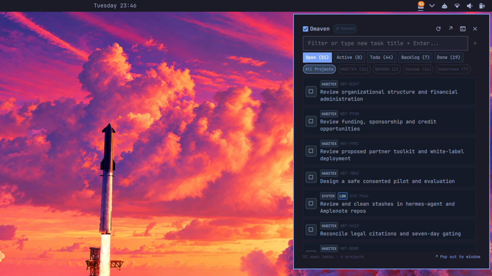

<div align="center">



# Omaven

**Local-first Aven Tasks for the Omarchy Desktop**

[](https://omarchy.org)
[](https://quickshell.outfoxxed.me)
[](LICENSE)
[](https://aventasks.dev)

</div>

---

**Omaven** is an Omarchy shell plugin that puts your locally installed and cloud-synced [Aven](https://aventasks.dev) tasks directly into your desktop workflow. Triage and complete tasks in a quick status bar popup, or expand into a full desktop window that can float and tile inside Hyprland.

---

## ✨ Features

- 📊 **Status Bar Integration**:
  - Live count badge displaying open tasks right on your bar.
  - Priority color accents (highlighting urgent/high tasks automatically).
  - Background sync indicator pulsing during remote sync.
  - **Left-Click**: Toggle the quick popup panel.
  - **Middle-Click**: Summon the floating/tiling desktop window.
  - **Right-Click**: Trigger an immediate background sync with your Aven server.

- ⚡ **Quick Status Popup**:
  - Anchored directly beneath the bar widget icon.
  - Real-time search and task filtering across all projects.
  - Quick-add input: type any task title and press `Enter` to create it instantly.
  - Quick filters: `Open`, `Active`, `Todo`, `Backlog`, `Done`.
  - Project filters: filter by `HABITEX`, `NEXORA`, `System`, `Underneon`, etc.
  - Single-click status cycling (`todo` ⇄ `done` ⇄ `active`).
  - Fast action buttons: set active (`󰐊`), delete (`󰩺`), open terminal TUI (`󰆍`), or expand to desktop window (`↗`).

- 🪟 **Hyprland-Native Desktop Window**:
  - A Wayland XDG toplevel window (`FloatingWindow`) that can **float or tile** seamlessly within Hyprland.
  - Centered floating window ($1040 \times 700$) by default; toggle instantly between tiling and floating with `Super + T`.
  - Global hotkey: `Super + Alt + A` to summon or dismiss anywhere.
  - Sidebar with dynamic project list, task counts, and remote server connectivity status.
  - Task inspector: edit titles, change status, update priority, and append notes.
  - Interactive "New Task" dialog and terminal TUI integration.

- 🛡️ **Security & Performance**:
  - Built strictly on Omarchy's `qs.Commons` and `qs.Ui` design kit.
  - Strict `Text.PlainText` rendering for untrusted user inputs (neutralizing rich text injection).
  - Sub-120ms atomic CLI bridge with local SQLite caching.

---

## 🚀 Installation

Install and place Omaven on your bar in one command:

```bash
omarchy plugin add https://github.com/frostmute/omaven --enable
omarchy bar put omaven --section right
```

**That's it!** No configuration files to edit or compositor restarts required.

### Opening Omaven
- **Quick Popup**: Click the `󰄲` icon in your bar.
- **Desktop Window**: Middle-click the bar icon, click `↗` inside the popup header, launch **Omaven** from your app launcher (`Super + Space`), or run `omaven` in a terminal.
- **Hyprland Native**: The desktop window is managed natively by Hyprland—press `Super + T` anytime to toggle between floating and tiling, drag to move, or snap to workspaces.

---

## ⌨️ Shortcuts & Controls

| Shortcut / Action | Context | Description |
|---|---|---|
| `Left-Click` | Bar icon | Open / close the quick popup panel |
| `Middle-Click` | Bar icon | Toggle the full desktop window |
| `Right-Click` | Bar icon | Run `aven sync` in the background |
| `Super + T` | Window focused | Toggle between floating and tiling (Hyprland native) |
| `Enter` | Search input | Create task with typed title (if not searching) |
| `/` | Desktop window | Focus task search field |
| `a` | Desktop window | Open "+ New Task" dialog |
| `s` | Desktop window | Sync with remote server |
| `Esc` | Popup / Window | Close current surface |

*(Optional)* If you want a global keyboard shortcut to toggle the desktop window from anywhere, you can add this line to `~/.config/hypr/bindings.lua`:
```lua
o.bind("SUPER + ALT + A", "Omaven: toggle desktop window", "omarchy-shell shell toggle omaven")
```

---

## 🗑️ Removal & Uninstallation

To remove Omaven from your Omarchy configuration:

```bash
omarchy plugin disable omaven
omarchy plugin remove omaven --yes
```

---

## 📦 Architecture

```
omaven/
├── manifest.json       Plugin manifest (kinds: bar-widget, panel)
├── BarWidget.qml       Bar button, live badge, and popout coordinator
├── PopupPanel.qml      Quick popup card anchored to the bar
├── Window.qml          Hyprland floating/tiling desktop window
├── AvenClient.qml      Reactive process manager and data store
├── bin/
│   └── aven-backend    Atomic CLI bridge running aven commands
├── assets/
│   ├── hero.svg        Vector hero artwork
│   └── preview.png     Rendered 16:9 banner preview
├── preview.png         Marketplace listing thumbnail
├── LICENSE             MIT License
└── README.md           Documentation
```

---

## 🔧 Prerequisites

- **Omarchy Linux** (Quattro shell with Hyprland).
- **Aven CLI** installed locally (`aven` binary on `PATH` or in `~/.local/bin/aven`).
  - Learn more about Aven at [aventasks.dev](https://aventasks.dev).

---

## 📄 License

Distributed under the [MIT License](LICENSE). Built for the [Omarchy](https://omarchy.org) desktop ecosystem.
